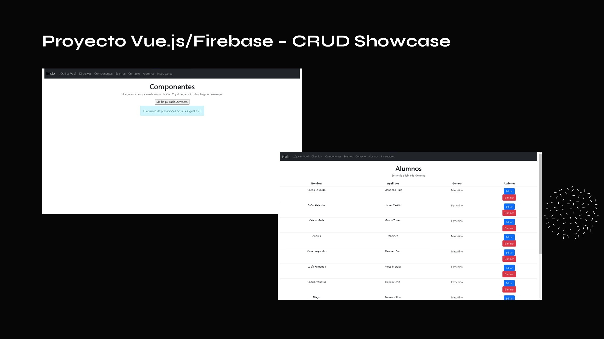

# CRUD Showcase 1 — Vue.js y Firebase

Aplicación web educativa de una sola página (*SPA*) desarrollada con **Vue.js**, **Vue Router**, **Bootstrap 5** y **Firebase Realtime Database**, que combina secciones didácticas sobre el framework con módulos CRUD para gestionar alumnos e instructores.

## Vista previa

## Características principales

- **Navegación SPA:** Enrutamiento en el cliente mediante **Vue Router** entre las secciones informativas y los módulos de gestión.
- **Módulo educativo de Vue:** Vistas dedicadas a *¿Qué es Vue?*, *Directivas*, *Componentes* (contador con límite de pulsaciones), *Eventos* y un formulario de *Contacto* con validación en el cliente.
- **CRUD de Alumnos:** Listado, creación, edición y eliminación de registros (`nombres`, `apellidos`, `género`) con validación de campos obligatorios.
- **CRUD de Instructores:** Listado, creación, edición y eliminación de registros (`nombres`, `apellidos`, `género`, `teléfono`, `email`) con validación en el cliente.

## Tecnologías utilizadas

- **HTML5** y **JavaScript**
- **Vue.js 2** y **Vue Router**
- **Axios** y **Fetch API** (consumo REST de **Firebase Realtime Database**)
- **Bootstrap 5.2.2** (vía CDN)

## Contexto y estado del proyecto

- **Contexto:** Aplicación educativa de práctica frontend con operaciones CRUD sobre Firebase Realtime Database.
- **Estado:** Finalizado (archivado para portafolio).

## Autor

**Daniel Alejandro Arita Leiva**
